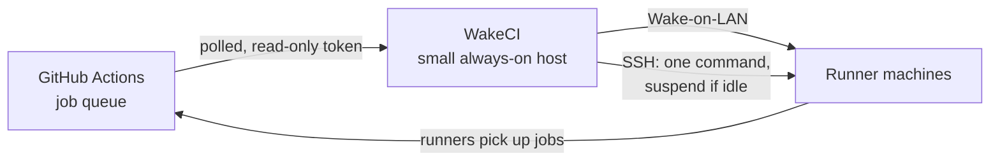

# WakeCI

[](https://github.com/badutis/wakeci/actions/workflows/ci.yml)
[](https://github.com/badutis/wakeci/releases)
[](LICENSE)

**Self-hosted GitHub Actions runners that sleep when there is no work.**

Your own CI machines run all day while most of the day nothing is queued. WakeCI watches
the job queue, wakes the machines a queued job needs, and suspends a machine once its runners
have been idle for a while. The first job after a quiet period waits while its machine
resumes (typically tens of seconds); the machines no longer run idle around the clock.



- **No Kubernetes, no cloud.** For runners on your own hardware: a lab, an office, a
  homelab. It runs on any small Linux host with systemd, such as an Orange Pi, MKS Pi or
  Raspberry Pi (512 MB RAM is plenty), or any x86 machine, on the same network segment as the
  runners.
- **Safe by design.** Read-only GitHub tokens. The SSH key can run one command, which
  suspends a machine only if no job is running on it. It needs no inbound connection, no
  incoming GitHub webhook, and no token that can change anything.
- **Nothing to install but Python.** Standard library only (3.9+), no Docker, no database.
  The only state on disk is a small file, written a few times a day.
- **Observable.** Prometheus `/metrics`, and webhook notifications to Discord, Slack or any
  JSON endpoint when something needs a person.
- **Careful by default.** It starts in `dry_run` and only logs what it would do until you
  turn that off.

**Start here:**

- [Requirements](#requirements) and [Install](#install);
- [Configuration](#configuration), checked by `wakeci check`;
- [`docs/design.md`](docs/design.md): how decisions are made, the security model and the
  known limits;
- [CONTRIBUTING.md](CONTRIBUTING.md), [SECURITY.md](SECURITY.md),
  [CHANGELOG.md](CHANGELOG.md).

| | Supported |
|---|---|
| Controller host | Linux with systemd; x86_64 and arm64 tested in CI, 32-bit ARM on real boards |
| Python | 3.9 to 3.13 on the controller (3.11+ for the dev tools) |
| Runner machines | Ubuntu or Debian with systemd, Wake-on-LAN and suspend-to-RAM |
| GitHub | github.com, repository and organisation runners |

## The `wakeci` command

```text
wakeci run CONFIG       run the controller (what the systemd unit starts)
wakeci check CONFIG     check a configuration; exit 0 when it is valid
wakeci discover ...     build or extend a configuration from the runners GitHub knows
wakeci version          print the version
```

`wakeci check` applies every rule the controller and the installer rely on, and refuses
unknown keys, so a typo such as `idle_minute` is reported instead of ignored. Run it
before every deploy; `deploy.sh` and `install.sh` run it too.

Installed with `pip install .` (or `pipx install .`) the command is on your path, for
checking configurations on your own computer. The package holds only the Python code: the
controller host is set up with `controller/deploy.sh` and `controller/install.sh` (below),
and its unit runs `python3 -m wakeci run /etc/wakeci/config.json`.

## Layout

| Path | Runs on | What it does |
|---|---|---|
| `wakeci/decide.py` | controller | when to wake and when to suspend; pure logic, no I/O |
| `wakeci/github.py` | controller | reads runners and queued jobs (GET only, ETag caching) |
| `wakeci/actions.py` | controller | Wake-on-LAN packet, suspend over SSH |
| `wakeci/main.py` | controller | the loop, `/metrics`, the state file |
| `controller/install.sh` | controller | installs or updates the controller on its host |
| `controller/deploy.sh` | your computer | packs one version with your configuration and installs it on the host |
| `controller/check_config.py` | both | checks a configuration before it is installed |
| `controller/` (other files) | controller | example configuration and the `systemd` unit |
| `machine/wakeci-sleep` | runner machine | suspends the machine unless a job is running |
| `machine/install.sh` | runner machine | installs `wakeci-sleep`, the `sudoers` rule, the restricted key and Wake-on-LAN |
| `scripts/public_safe.py` | CI, pre-push | refuses private addresses, MAC addresses, personal emails and AI attribution |
| `scripts/pre-push`, `scripts/install-hooks.sh` | your computer | runs that check before every push |

## Requirements

**The controller host:**

- Linux with **systemd**, **Python 3.9+** with its standard library, and the OpenSSH
  client. On Debian, Ubuntu, Raspberry Pi OS and Armbian the installer adds missing
  packages with `apt`. Elsewhere (Fedora, Arch, …) install them first. Non-systemd systems
  such as Alpine are not supported.
- Any CPU architecture: the controller is pure Python and shell, with nothing to compile.
  CI installs and starts it on x86_64 and arm64 (Ubuntu 24.04). 32-bit ARM (for example an
  Orange Pi Zero) has no GitHub-hosted runner, so it is tested on real boards only.
- Little memory and CPU: one Python process polling every 20 s.

**The runner machines:**

- Ubuntu or Debian with systemd (`machine/install.sh` uses `apt` for `ethtool`).
- Runner machines with Wake-on-LAN and working suspend-to-RAM, enabled in the BIOS.
  Check this by hand on one machine first: suspend it, wake it with a packet from
  another machine, and confirm its runners come back online in GitHub.
- The controller on the **same layer-2 segment** (VLAN) as the machines. Wake-on-LAN
  broadcasts do not cross routers.
- Runners registered with a name prefix per machine (for example `host1-a-1`,
  `host1-a-2`), so that the controller can tell which machine a runner belongs to.

## Install

**On each runner machine** (as root, from a checkout of this repository):

```bash
sudo bash machine/install.sh --user wakeci --ci-user runner --pubkey /tmp/wakeci.pub
```

- `--user` is the account the controller logs in as. It gets the controller's public key,
  restricted to the single command `sudo -n /usr/local/sbin/wakeci-sleep`.
- `--ci-user` is the account that runs CI jobs. The script refuses to give it the key.
- `--iface` (default `eno1`) is the interface Wake-on-LAN is enabled on.

Running the script again changes nothing.

**On the controller host.** Start from a minimal system: on an ARM board, its minimal
Debian-based image (Armbian *minimal*, Raspberry Pi OS *Lite*), with no desktop and no
Docker; on an x86 machine, a server install of Debian or Ubuntu. SSH into it as a user with
`sudo`. Then, from a checkout of this repository on your own computer:

```bash
controller/deploy.sh <ssh-target> v0.2.0 /path/to/your/config.json
```

On a board that runs from an SD card, add `--ram-journal` (before `<ssh-target>`). It keeps
the systemd journal of the whole host in RAM, so all logs are lost on reboot. Leave it out
on a machine with a real disk.

`deploy.sh` packs that tag's code (`git archive`, not your working tree) and your
`config.json`, checks the configuration with that version's checker (the SSH key,
`known_hosts` and the token files must be directly in `/etc/wakeci/`), copies the bundle
with `scp` and runs `controller/install.sh` on the host with `sudo`. The host needs no
access to GitHub for this.

`install.sh` runs as root on the host. It:

1. checks that the host runs systemd; prints its model, architecture and memory; installs
   `python3` and `openssh-client` with `apt` if they are missing (elsewhere it stops and
   says what to install);
2. creates the system user `wakeci` (no home, no login shell);
3. puts the code at `/opt/wakeci/wakeci/` (owned by root, precompiled) and a copy of
   the installer at `/opt/wakeci/controller/`;
4. installs the configuration as `/etc/wakeci/config.json` (`0640`, group `wakeci`);
5. creates the SSH key for the machines **on the host**, if there is none yet
   (`/etc/wakeci/id_ed25519`, `0600`, owner `wakeci`), and prints its public key for
   `machine/install.sh --pubkey`;
6. scans the host key of every machine that is not in `known_hosts` yet, and prints its
   fingerprint. Compare it with `ssh-keygen -lf /etc/ssh/ssh_host_ed25519_key.pub` on the
   machine. A sleeping machine cannot be scanned: run the installer again once it is
   awake. Until then the controller cannot suspend it;
7. with `--ram-journal` only, keeps the systemd journal in RAM (`Storage=volatile`);
8. installs and enables `wakeci.service`, and starts it only if every token file the
   configuration names exists and is readable by `wakeci`.

A run without `--set-token` never replaces an existing SSH key, host key or token. Run it
again at any time:

```bash
sudo bash /opt/wakeci/controller/install.sh
```

**Tokens** are typed on the host, never put in the bundle:

```bash
ssh -t <ssh-target> sudo bash /opt/wakeci/controller/install.sh --set-token token-example-org
```

This reads the token without echoing it and writes `/etc/wakeci/<name>` (`0600`, owner
`wakeci`). The name must match the `token_file` in your configuration. The webhook URL
for notifications (below) is set the same way: `--set-token notify-url`. When every file
is in place, run the installer again to start the service.

**Watch it** with `journalctl -u wakeci -f` and `curl http://<host>:9105/metrics`.
While `"dry_run": true`, it only logs what it would do. When the log looks right, set
`"dry_run": false` in your configuration and deploy again.

**Upgrading from `rackctl` (v0.1.0-v0.3.0).** The project was renamed in v0.4.0, and every
name changed with it. The new install does not touch the old one, so on the controller host:

1. Stop the old unit: `systemctl disable --now rackctl`.
2. Install WakeCI as above. It creates a new SSH key and asks for the tokens again
   (`--set-token`), and the configuration paths become `/etc/wakeci/…`.
3. On every runner machine, run the new `machine/install.sh` with the new public key. Then
   remove `/usr/local/sbin/rack-sleep`, `/etc/sudoers.d/rack-sleep` and the old key line in
   `authorized_keys`.
4. Remove `/etc/rackctl`, `/opt/rackctl`, `/etc/systemd/system/rackctl.service` and the
   `rackctl` user.
5. Monitoring: the metrics are now `wakeci_*`.

## Generating a configuration

`wakeci discover` reads the runners of your sources from GitHub and groups them into
machines. Run it on your own computer with a read-only token (see [Tokens](#tokens)); it
makes GET requests only and never prints or writes the token.

```bash
# A new configuration, to standard output:
wakeci discover \
  --source orgs/example-org --repos example-org/app,example-org/lib --token-file ~/.config/wakeci/token-a \
  --source repos/example-org2/tool --repos example-org2/tool --token-file ~/.config/wakeci/token-b \
  > config.json

# Machines for new runners, added to an existing configuration:
wakeci discover --update config.json \
  --token orgs/example-org=~/.config/wakeci/token-a --token repos/example-org2/tool=~/.config/wakeci/token-b
```

- A runner's **prefix** is its name without a number after a separator: `ci5-3` becomes
  `ci5-`. A name without one (`host1`) is its own prefix, because stripping the number would
  put `host1` and `host10` on one machine.
- A runner an existing machine's prefix matches stays with that machine. Every other
  prefix becomes **a machine of its own**, with `mac` and `host` set to `FILL-IN`, which
  `wakeci check` refuses until you fill them in. GitHub knows neither.
- Several prefixes on one machine (`ci5-` and `runner5-cpp-`) are only **suggested** for
  joining, never joined: a wrong join would suspend a machine on which another machine's
  runner works. Join them with `--machine runner5=ci5-,runner5-cpp-`.
- `--update` **never changes or removes** anything in the file. Prefixes that no runner
  matches any more are only reported. Without `--write` the result goes to standard output
  and the diff to standard error; with `--write` the file is replaced (the old one is kept
  as `config.json.bak`; a symbolic link is followed, and the mode and owner are kept).
  The file is written back with two-space indentation, whatever its formatting was.
- The token can also come from `WAKECI_TOKEN` when there is one source. `--json` prints
  the configuration and the report together.

## Configuration

Start from `controller/config.example.json`, or generate one with `wakeci discover`. Its first two keys are worth keeping:

- `"$schema"` points editors such as VS Code to
  [`docs/config.schema.json`](docs/config.schema.json), which gives completion and checks
  while you type;
- `"config_version": 1` is the format version. A future incompatible format raises it, and
  WakeCI refuses a version it does not know instead of misreading the file. Without it
  the file is read as version 1; `wakeci check`, the installer and the controller's log
  warn about it.

| Key | Default | Meaning |
|---|---|---|
| `dry_run` | `true` | log decisions without sending packets or SSH commands |
| `poll_seconds` | `20` | how often GitHub is polled |
| `idle_minutes` | `30` | how long all runners of a machine must be idle before it is suspended |
| `broadcast` | `255.255.255.255` | where Wake-on-LAN packets are sent (the segment's broadcast address) |
| `metrics_listen` | `0.0.0.0:9105` | address of the `/metrics` endpoint |
| `state_file` | `/var/lib/wakeci/last-online.json` | when each machine was last online |
| `ssh_key` | — | private key used for `wakeci-sleep` |
| `known_hosts` | `/etc/wakeci/known_hosts` | host keys of the machines (checked strictly) |
| `notify` | — | optional: where to send notifications (below) |
| `sources[]` | — | where runners are registered and whose jobs use them (below) |
| `machines[]` | — | the machines (below) |

A **source** is one place where runners are registered, plus the repositories whose jobs
those runners take:

- `runners_path`: `repos/<owner>/<repo>` for repository runners, or `orgs/<org>` for
  organisation runners;
- `repos`: the repositories whose queued jobs are watched;
- `token_file`: a file that holds a read-only token for this source.

A runner only counts for a job from the same source, and only if it has every label
the job asks for. This is the same rule GitHub uses to assign jobs.

A **machine** has:

- `name`: letters, digits, `.`, `_` and `-` (it is also the machine label in `/metrics`);
- `mac` and `host`;
- `ssh_user` (defaults to `name`);
- `runner_prefixes`: every runner whose name starts with one of them belongs to this
  machine;
- `rank`: lower ranks are woken first, so give faster machines a lower number.

Every machine needs its own MAC and host, and no two machines may share a runner prefix.
A prefix should end where the number ends (`host1-`, not `host1`): otherwise `host1`
also matches the runners of `host10-`, which then belong to both machines, and
`wakeci check` warns about it. A value that still holds `FILL-IN` is refused.

### Tokens

Use one fine-grained personal access token per source, with read access only:

- **repository source:** Actions: read, and Administration: read (needed to list
  repository runners);
- **organisation source:** Actions: read on the repositories, and Self-hosted runners:
  read on the organisation.

Check the exact permission names when you create the tokens: GitHub renames them from
time to time. A stolen token can read the queue and nothing else.

## Notifications

Without a `notify` block every warning goes only to the journal. With one, the controller
also posts to a webhook (a Discord or Slack channel, or anything that takes JSON):

```json
"notify": {
  "url_file": "/etc/wakeci/notify-url",
  "format": "discord",
  "after_minutes": 10,
  "repeat_hours": 6
}
```

- `url_file` holds the webhook URL. The URL is a secret, because anyone who has it can post
  to your channel. So it lives in its own file in `/etc/wakeci/`, set with
  `install.sh --set-token notify-url`, and it is never written to the log.
- `format`: `discord` (`{"content": …}`, mentions disabled), `slack` (`{"text": …}`) or
  `json` (`{"event", "key", "text", "resolved"}`).
- `after_minutes` (default 10): how long a problem must last before it is reported, so a
  short network drop stays quiet.
- `repeat_hours` (default 6): how often the message repeats while the problem lasts.

What is sent:

| Event | When | "Resolved" message | In `dry_run` |
|---|---|---|---|
| a GitHub source cannot be read | for `after_minutes` without a break; nothing is suspended meanwhile | yes | yes |
| the GitHub request limit is nearly used up | at once; polling waits for the reset | yes | yes |
| the controller started | each start (version, machine count, `dry_run`) | — | yes |
| a machine did not wake up | after the second wake attempt | — | no (nothing is sent to it) |
| a machine failed to suspend | three times in a row | — | no (nothing is sent to it) |

Messages are posted from a separate thread. A slow or broken webhook never holds up the
control loop. A post that fails (an error answer, a rate limit, a timeout) is logged
without the URL, counted once in `wakeci_notify_failed_total` and sent again every 5
minutes, for up to 24 hours, with the time it first failed. A retry is dropped when it
has gone stale: the problem ended, or for a "resolved" message the problem came back and was
reported, or a newer message with the same subject was sent.
A redirect counts as a failure, because following it would silently drop the message.
The URL must be `https` (plain `http` only to `localhost`, for a local relay).

## Metrics

`GET /metrics` returns the Prometheus text format:

| Metric | Type | Labels |
|---|---|---|
| `wakeci_machine_awake` | gauge | `machine` |
| `wakeci_machine_waking` | gauge | `machine` |
| `wakeci_actions_total` | counter | `kind`, `machine` |
| `wakeci_runner_busy_seconds_total` | counter | `runner` |
| `wakeci_queued_jobs` | gauge | `labels` |
| `wakeci_queued_oldest_seconds` | gauge | `labels` |
| `wakeci_github_ok` | gauge | `source` |
| `wakeci_github_remaining` | gauge | `source` |
| `wakeci_dry_run` | gauge | — |
| `wakeci_notify_failed_total` | counter | — |

The names are pinned by a test (`tests/test_io.py`). A monitoring system that scrapes
them breaks without any error when a name changes.

## Development

```bash
python3 -m unittest discover -s tests -t .
shellcheck machine/install.sh machine/wakeci-sleep controller/install.sh controller/deploy.sh tests/install_smoke.sh scripts/pre-push scripts/install-hooks.sh
python3 scripts/public_safe.py --history
```

Lint, formatting, types and coverage use pinned tools (installed by hash, never a newer
release by surprise). They need Python 3.11 or newer (CI uses 3.13), in a virtual
environment:

```bash
python3 -m venv .venv && . .venv/bin/activate
python3 -m pip install --require-hashes --no-deps -r requirements-dev.txt
ruff check . && ruff format --check . && mypy
coverage run -m unittest discover -s tests -t . && coverage report
```

CI runs these on GitHub-hosted runners, and also `tests/install_smoke.sh` on x86_64 and on
arm64. That script installs the controller from scratch on a clean Ubuntu with systemd and
starts it with fake tokens. It changes the system, so never run it on a real host. CI never
runs on the self-hosted runners, because those are the machines this controller suspends.

**Nothing installation-specific goes into this repository.** That means no real IP or
MAC addresses, no machine, user or repository names, no tokens and no personal email
addresses. Examples use the documentation ranges (`192.0.2.0/24`,
`00:00:5e:00:53:xx`) and `example-org`. Your real configuration lives in your own
infrastructure repository.

`scripts/public_safe.py` catches the leaks that have a recognisable shape: private
addresses, MAC addresses, personal emails and AI attribution. It checks the whole history
of the branch and of every tag, and every tag object, not only the latest commit. It cannot recognise public
addresses or the names of real machines, users and repositories. Keeping those out is
up to the author.

The guard scans its own source too, so nothing in it may look like a finding: networks are
written as numbers and tool names are built from pieces. A test checks this. Earlier
versions of the file, which spelled the patterns out, are skipped by their exact object id.

CI runs that check only after a push, when the commit is already public. Install the
pre-push hook once per clone, so that a push holding a finding is refused on your own
computer instead:

```bash
scripts/install-hooks.sh
```

For every ref you push (any branch or tag), it checks the whole history of that commit and
every tag object on the way to it. Ref deletions pass. A local tag you do not push is not
checked. On a branch whose guard is too old for the hook, the push is refused with a message
saying so. The installer refuses when `core.hooksPath` is set: that directory is shared, so
put the hook there yourself if you want it. Run the installer again after `scripts/pre-push`
changes.

## Releases

A release is an annotated tag `vX.Y.Z` on `main`, matching `__version__` in
`wakeci/__init__.py` and a `## [X.Y.Z]` section in `CHANGELOG.md`. Pushing the tag runs
`.github/workflows/release.yml`, which:

1. checks the version, the tag and the changelog (`scripts/release.py check`);
2. runs the guard over the whole history, and the tests;
3. builds the wheel and the sdist with build tools pinned by hash
   (`requirements-release.txt`, no build isolation);
4. installs the wheel and runs it;
5. writes `SHA256SUMS`, attests the build provenance of each artifact, and publishes the
   GitHub release with the changelog section as notes.

Verify a downloaded artifact:

```bash
sha256sum -c --ignore-missing SHA256SUMS
gh attestation verify wakeci-X.Y.Z-py3-none-any.whl --repo badutis/wakeci \
  --signer-workflow badutis/wakeci/.github/workflows/release.yml --source-ref refs/tags/vX.Y.Z
```

Running the workflow by hand on a branch rehearses steps 1-4 without publishing anything.

## Status

Not yet deployed. Run it a week with `"dry_run": true` before turning that off.
