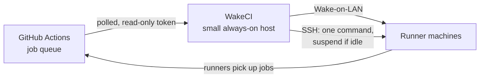

# WakeCI

[](https://github.com/badutis/wakeci/actions/workflows/ci.yml)
[](https://github.com/badutis/wakeci/releases)
[](LICENSE)

**Self-hosted GitHub Actions runners that sleep when there is no work.**

Your own CI machines run all day while most of the day nothing is queued. WakeCI watches
the job queue, wakes the machines a queued job needs, and suspends a machine once its runners
have been idle for a while. The first job after a quiet period waits while its machine
resumes (typically tens of seconds); the machines no longer run idle around the clock.



- **No Kubernetes, no cloud.** For runners on your own hardware: a lab, an office, a
  homelab. It runs on any small Linux host with systemd, such as an Orange Pi, MKS Pi or
  Raspberry Pi (512 MB RAM is plenty), or any x86 machine, on the same network segment as the
  runners.
- **Safe by design.** Read-only GitHub tokens. The SSH key can run one command, which
  suspends a machine only if no job is running on it. It needs no inbound connection, no
  incoming GitHub webhook, and no token that can change anything.
- **Nothing to install but Python.** Standard library only (3.9+), no Docker, no database.
  The only state on disk is a small file, written a few times a day.
- **Observable.** Prometheus `/metrics`, and webhook notifications to Discord, Slack or any
  JSON endpoint when something needs a person.
- **Careful by default.** It starts in `dry_run` and only logs what it would do until you
  turn that off.

| | Supported |
|---|---|
| Controller host | Linux with systemd; x86_64 and arm64 tested in CI, 32-bit ARM on real boards |
| Python | 3.9 to 3.13 on the controller (3.11+ for the dev tools) |
| Runner machines | Ubuntu or Debian with systemd, Wake-on-LAN and suspend-to-RAM |
| GitHub | github.com, repository and organisation runners |

## Documentation

**[badutis.github.io/wakeci](https://badutis.github.io/wakeci/)**, also readable here in
[`docs/`](docs/index.md):

- [Getting started](docs/getting-started.md): from runners on GitHub to a controller in
  `dry_run`, step by step;
- [Install](docs/install.md), [Configuration](docs/configuration.md),
  [Generating a configuration](docs/discover.md), [Commands](docs/commands.md);
- [Troubleshooting](docs/troubleshooting.md): what each `wakeci doctor` finding means;
- [Monitoring](docs/monitoring.md): notifications and metrics;
- [How it works](docs/design.md): decisions, the security model and the known limits;
- [Development](docs/development.md); [CONTRIBUTING.md](CONTRIBUTING.md),
  [SECURITY.md](SECURITY.md), [CHANGELOG.md](CHANGELOG.md).

## In short

```bash
wakeci discover --source orgs/example-org --repos example-org/app --token-file token > config.json
controller/deploy.sh <ssh-target> vX.Y.Z config.json          # the controller host
sudo bash machine/install.sh --user wakeci --ci-user runner --pubkey wakeci.pub   # each machine
sudo -u wakeci python3 /opt/wakeci/controller/doctor.py /etc/wakeci/config.json   # check it all
```

Then a week in `"dry_run": true`, and turn it on. Each step is explained in
[Getting started](docs/getting-started.md).

## Status

Not yet deployed. Run it a week with `"dry_run": true` before turning that off.
